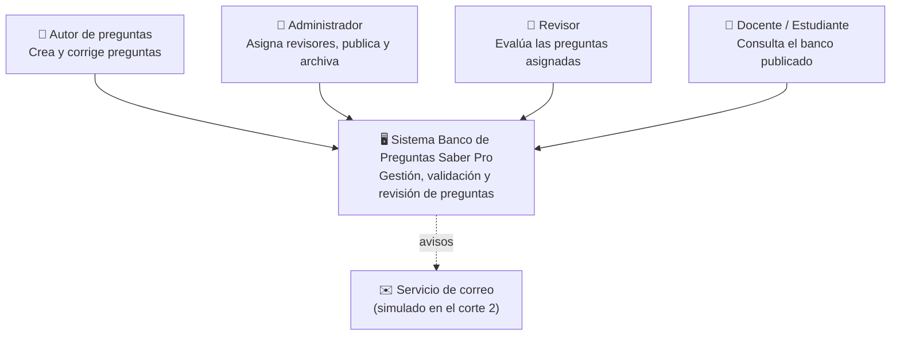
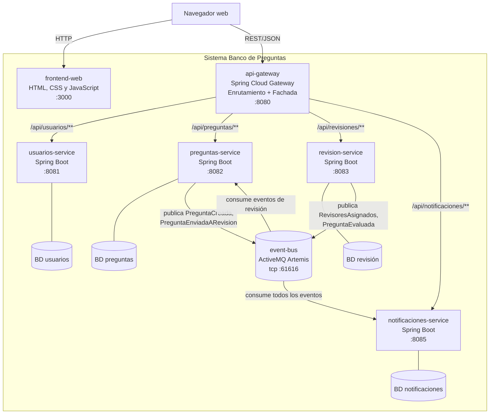
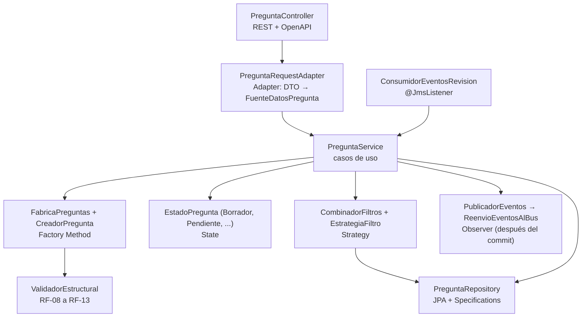
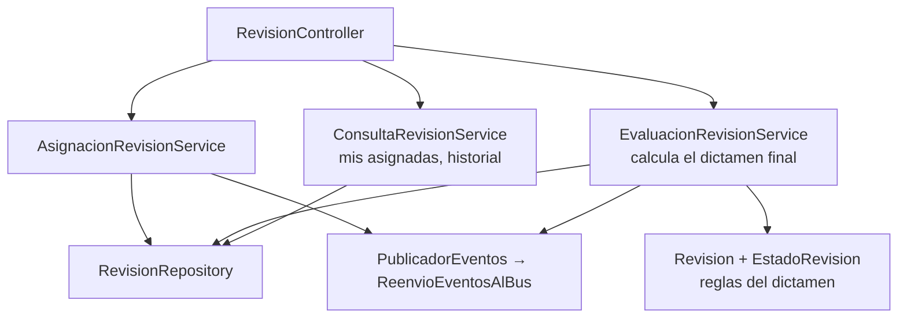
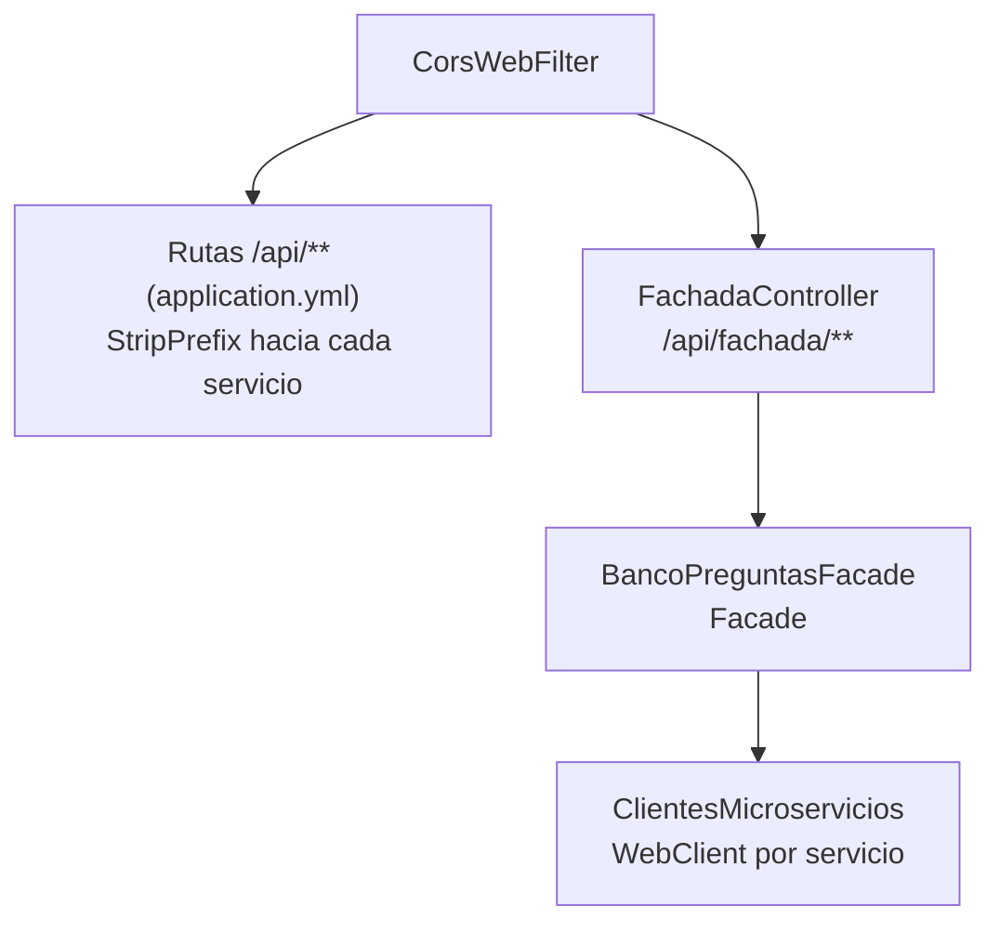
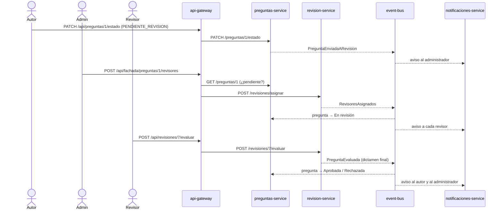

# Arquitectura C4 — Corte 2: microservicios orientados a eventos

## Nivel 1 — Contexto del sistema

## Nivel 2 — Contenedores

| Contenedor | Tecnología | Responsabilidad |
|---|---|---|
| `frontend-web` | HTML, CSS y JavaScript sin frameworks, servido por Spring Boot | Interfaz web por rol. Solo conoce la URL del gateway. |
| `api-gateway` | Spring Cloud Gateway (WebFlux) | Punto de entrada único, CORS y fachada de operaciones compuestas. |
| `usuarios-service` | Spring Boot, JPA, Argon2id | Registro, autenticación y roles. |
| `preguntas-service` | Spring Boot, JPA, JMS, OpenAPI | Autoría, validación estructural, ciclo de vida y consulta paginada. |
| `revision-service` | Spring Boot, JPA, JMS, OpenAPI | Asignación de revisores, evaluación e historial. |
| `notificaciones-service` | Spring Boot, JPA, JMS | Bandeja de avisos generada a partir de los eventos. |
| `event-bus` | ActiveMQ Artemis embebido | Tópicos con suscripciones durables compartidas. |
| Bases de datos | H2 en archivo (desarrollo) / PostgreSQL (perfil `postgres`) | Una por servicio: ningún servicio lee la base de otro. |

## Nivel 3 — Componentes

### preguntas-service

### revision-service

### api-gateway

### notificaciones-service y usuarios-service

- **notificaciones-service:** `ConsumidorEventos` (un `@JmsListener` por tópico) → `NotificacionService`
  (decide destinatarios) → `NotificacionRepository` y `CanalNotificacion` (correo simulado).
  `PreguntaConocida` es la proyección local *pregunta → autor*.
- **usuarios-service:** `UsuarioController` → `UsuarioService` → `UsuarioRepository`, con
  `HasherPassword` (Argon2id) y `ValidadorPassword`. `DatosIniciales` crea los usuarios de demostración.

## Flujo principal (HU-2, HU-4 y HU-5)

## Patrones de diseño GoF aplicados

| Patrón | Tipo | Dónde | Para qué |
|---|---|---|---|
| Builder | Creacional | `Pregunta.Builder` (heredado del corte 1) | Armar una pregunta paso a paso. |
| Factory Method | Creacional | `CreadorPregunta` / `CreadorPreguntaSeleccionMultiple` | Cada tipo de pregunta define cómo se construye; el algoritmo común valida y entrega en Borrador. |
| State | Comportamiento | `EstadoPregunta` y sus 7 estados | Cada estado decide sus transiciones válidas (RF-14, RF-15). |
| Strategy | Comportamiento | `EstrategiaFiltro` y sus 6 filtros | Filtros intercambiables combinados en una sola consulta paginada. |
| Observer | Comportamiento | Eventos de dominio + bus + `@JmsListener` | Los servicios reaccionan a lo que pasa en otros sin acoplarse. |
| Adapter | Estructural | `PreguntaRequestAdapter` | Adapta el DTO REST a la interfaz que espera el dominio. |
| Facade | Estructural | `BancoPreguntasFacade` | Operaciones compuestas sobre 3 servicios con una sola llamada. |

## Decisiones de arquitectura del corte 2

- **Bus de eventos con Artemis embebido:** permite ejecutar todo el sistema solo con Java (sin Docker,
  RabbitMQ ni Kafka). En producción se usa un broker Artemis independiente cambiando
  `spring.artemis.broker-url`.
- **Suscripciones durables compartidas:** si un servicio está caído, sus eventos esperan en el bus;
  si hay varias instancias, se reparten los mensajes (ver el escenario de escalabilidad).
- **Eventos publicados después del commit:** `@TransactionalEventListener` evita anunciar cambios que
  luego se deshacen.
- **Base de datos por servicio:** H2 en archivo para desarrollo y PostgreSQL con el perfil `postgres`.
- **Contratos por nombre lógico:** cada mensaje lleva en la cabecera `_tipo` el nombre del evento
  (`PreguntaCreada`, ...). Cada servicio define su propia clase con solo los campos que usa, así un
  productor puede agregar campos sin romper a los consumidores (ver [EVENTOS.md](EVENTOS.md)).
