# Contextos delimitados (Bounded Contexts) — Corte 2

Adaptación de la Figura 1 del documento del proyecto al alcance que implementa el equipo en el
segundo corte. Cada contexto delimitado es un microservicio con su propio modelo y su propia base
de datos; se comunican por eventos a través del bus y, cuando el usuario necesita una respuesta
inmediata, por REST a través del API Gateway.

```mermaid
flowchart LR
    subgraph IDENT["Contexto de Identidad<br/>(usuarios-service)"]
        U1[Usuario]
        U2[Rol]
        U3[Credenciales Argon2id]
    end

    subgraph AUT["Contexto de Autoría<br/>(preguntas-service)"]
        A1[Pregunta]
        A2[Estado de la pregunta<br/>patrón State]
        A3[Validación estructural]
        A4[Fábrica de preguntas<br/>Factory Method]
    end

    subgraph REV["Contexto de Revisión por Pares<br/>(revision-service)"]
        R1[Revisión]
        R2[Dictamen y observaciones]
        R3[Historial de revisiones]
    end

    subgraph NOT["Contexto de Notificaciones<br/>(notificaciones-service)"]
        N1[Notificación]
        N2[Proyección: pregunta → autor]
    end

    AUT -- "PreguntaCreada<br/>PreguntaEnviadaARevision" --> NOT
    REV -- "RevisoresAsignados<br/>PreguntaEvaluada" --> AUT
    REV -- "RevisoresAsignados<br/>PreguntaEvaluada" --> NOT
    IDENT -. "identificadores de usuario<br/>(autorId, revisorId)" .-> AUT
    IDENT -. "identificadores de usuario" .-> REV
```

## Descripción de cada contexto

| Contexto | Responsabilidad | Lenguaje ubicuo | Servicio |
|---|---|---|---|
| Identidad | Registrar usuarios, autenticarlos y conocer su rol (HU01). | Usuario, rol, credencial, estado activo/inactivo | `usuarios-service` |
| Autoría | Crear y editar preguntas, validarlas estructuralmente y gestionar su ciclo de vida; consultarlas con filtros (HU02, HU03, HU04). | Pregunta, contexto, enunciado, distractor, clave, borrador, pendiente de revisión, publicada | `preguntas-service` |
| Revisión por pares | Asignar revisores, registrar su dictamen con observaciones y conservar el historial (HU05). | Revisión, revisor, dictamen, aprobada, rechazada, observación | `revision-service` |
| Notificaciones | Avisar a los implicados de lo que ocurre en los demás contextos. | Notificación, destinatario, bandeja | `notificaciones-service` |

## Relaciones entre contextos

- **Autoría → Notificaciones (publicador/suscriptor):** Autoría anuncia que se creó una pregunta o
  que se envió a revisión. Notificaciones guarda una proyección *pregunta → autor* para saber a quién
  avisar más adelante sin consultar a Autoría.
- **Revisión → Autoría (publicador/suscriptor):** al asignar revisores la pregunta pasa a *En revisión*;
  cuando todos los revisores emiten su dictamen, Autoría la pasa a *Aprobada* o *Rechazada*. Revisión
  nunca modifica directamente los datos de Autoría.
- **Identidad → resto (núcleo compartido mínimo):** los demás contextos solo guardan identificadores de
  usuario. Las validaciones que necesitan datos de Identidad (por ejemplo, que un usuario sea revisor)
  las hace la fachada del API Gateway antes de llamar a Revisión.

## Contextos de la Figura 1 que quedan fuera del corte 2

Simulacros (HU06), Seguimiento académico (HU07) y Administración/auditoría (HU08) se mantienen como
contextos futuros. La arquitectura los admite sin cambios en los servicios actuales: bastaría con
suscribirlos a los eventos ya publicados (por ejemplo, Simulacros escucharía las preguntas publicadas).
